  

# 🚀 Awesome Android APK Launchers & Emulation Setup

**A curated index of top-tier SaaS/hosted Android platforms, APK desktop launchers, containerized runtimes, and open-source Android virtualization solutions.**

*Optimized for developers, QA automation teams, gamers, DevOps engineers, and self-hosters running Android on Windows, Linux, macOS, and Cloud infrastructure.*

---

## 📑 Table of Contents

- [🌐 Sector Overview & Market Dynamics](#-sector-overview--market-dynamics)
- [☁️ SaaS & Hosted Platforms](#️-saas--hosted-platforms)
- [🛠️ Open-Source GitHub Projects](#️-open-source-github-projects)
- [🤝 How to Contribute](#-how-to-contribute)
- [💖 Support & Sponsorship](#-support--sponsorship)
- [⭐ Star History](#-star-history)
- [📜 Disclaimer](#-disclaimer)

---

## 🌐 Sector Overview & Market Dynamics

The global Android emulation and virtualization sector is valued at approximately **$860M – $1.5B** in 2024–2026 and is projected to expand toward **$3B – $5B+** by 2033 at a compound annual growth rate (CAGR) of **~11–13%**. This explosive growth is powered by demand for cross-platform mobile gaming, mobile app developer testing, automated CI/CD device pipelines, and cloud phone streaming.

The sector is **moderately fragmented**:
- **Consumer Desktop Gaming & Multi-Instance Virtualization:** Exhibits a consolidated oligopoly dominated by large players including NetEase MuMu Player, BlueStacks (now.gg), LDPlayer, and Microvirt (NoxPlayer, MEmu Play).
- **Enterprise Testing & Cloud Android Runtimes:** Features specialized enterprise solutions (Genymotion Cloud, Google AVD, BrowserStack) paired with a rapidly growing open-source containerized movement (scrcpy, Waydroid, Redroid, Docker-Android) transforming self-hosted device farms.

---

## ☁️ SaaS & Hosted Platforms

A comprehensive overview of leading hosted platforms and desktop commercial Android app players. The table below includes verified transparent starting tiers, free allowances, and company scale sorted descending by corporate valuation and revenue.

| Platform | Company Valuation / Revenue | Starting Pricing Tier | Free Tier / Trial Limits | Description |
| :--- | :--- | :--- | :--- | :--- |
| **[MuMu Player](https://mumuplayer.com)** | **$55B – $65B Valuation** (~$14.5B – $16B Annual Revenue, NetEase NASDAQ: NTES) | $10.00/month (Pro subscription for Mac/advanced features) | Free forever plan available on Windows (ad-supported desktop emulator); paid Pro versions offer a 7-day free trial | NetEase-developed Android emulator for Windows and macOS featuring high-refresh-rate rendering, Vulkan graphic support, and low latency. |
| **[BlueStacks](https://bluestacks.com)** | **~$50M – $100M+ Valuation** (Est. ~$30M – $50M Annual Revenue, now.gg Inc.) | $7.99/month (BlueStacks Prime ad-free subscription) | Free forever plan with full access to emulator and cloud gaming (ad-supported with promotional game banners and notifications) | High-performance desktop Android emulator and cloud gaming platform optimized for Windows and macOS. |
| **[Genymotion Cloud](https://genymotion.com)** | **~$10M – $20M Valuation** (~$6M ARR, Acquired by Shadow / OVHcloud ecosystem) | $0.05/minute (Pay-As-You-Go usage) or $179/month per virtual device (Unlimited plan) | Free trial with 60 free minutes (max 2 concurrent virtual devices for individual accounts) or 1,000 free minutes (max 10 concurrent devices for enterprise trials upon approval) | Cloud-based and desktop Android virtualization platform designed for automated app testing, CI/CD pipelines, and device simulation. |
| **[NoxPlayer](https://bignox.com)** | **~$10M – $30M Valuation** (Est. ~$5M – $15M Annual Revenue, Microvirt Beijing) | $3.69/month (NoxPlayer VIP / Premium plan) | Free forever plan with full access to multi-instance emulation and keymapping (ad-supported with startup screens and sponsored app icons) | Desktop Android emulator supporting custom keymapping, macro recording, and simultaneous multi-instance execution. |
| **[LDPlayer](https://ldplayer.net)** | **~$10M – $25M Valuation** (Est. ~$5M – $12M Annual Revenue, Xuanzhi International) | $2.99/month (LD Premium subscription) | Free forever plan with unlimited emulator instances and high-FPS gaming (ad-supported with sponsored desktop recommendations) | Lightweight Windows Android emulator built on VirtualBox technology for high-FPS gaming and multi-instance management. |
| **[MEmu Play](https://memuplay.com)** | **~$5M – $15M Valuation** (Est. ~$3M – $8M Annual Revenue, Microvirt) | $2.99/month (MEmu Premium plan) | Free forever plan with unlimited virtualization sessions (ad-supported interface with promotional task dock recommendations) | Windows-focused Android emulator offering AMD/Intel virtualization acceleration and flexible device profile spoofing. |
| **[Andy (Andyroid)](https://andyroid.net)** | **Defunct / Abandoned** (<$1M Historical Revenue) | Free freeware (historically bundled third-party installer software) | Free forever plan (adware-bundled freeware model; software is obsolete/unmaintained) | Desktop Android virtual machine solution enabling mobile-to-PC synchronization (historical/legacy). |
| **[KoPlayer](https://koplayer.com)** | **Discontinued / Defunct** (<$1M Historical Revenue) | Free freeware (historically ad-supported freeware) | Free forever plan (legacy freeware; official servers offline and software unmaintained) | Freeware x86-architecture Android emulator geared toward running mobile games and APKs on desktop systems (legacy). |

---

## 🛠️ Open-Source GitHub Projects

Explore the finest open-source Android virtualization platforms, APK launchers, container engines, and control utilities. Repositories are dynamically ranked by popularity (**GitHub Stars_Count in descending order**), each with a social Stars_Badge linking straight to its GitHub stargazers.

- **[scrcpy](https://github.com/Genymobile/scrcpy)**  ⚡  
  Ultra-low-latency display and control tool for mirroring and controlling physical or virtual Android devices via USB or TCP/IP without requiring root access.

- **[Magisk](https://github.com/topjohnwu/Magisk)**  🪄  
  The ubiquitous open-source Android rooting and systemless customization utility, vital for patching emulators, AVD images, and testing rooted environments.

- **[Appium](https://github.com/appium/appium)**  🤖  
  Leading cross-platform test automation framework for native, hybrid, and mobile web apps on Android emulators, simulators, and real devices using the W3C WebDriver protocol.

- **[docker-android](https://github.com/budtmo/docker-android)**  🐳  
  Complete Android in Docker solution with integrated noVNC web interface, video recording, Appium automation, and AI-agent test execution support.

- **[STF (Smartphone Test Farm)](https://github.com/openstf/stf)**  📱  
  Production-grade web application for controlling and managing Android devices remotely from your browser across distributed teams.

- **[Waydroid](https://github.com/waydroid/waydroid)**  🐧  
  Container-based runtime using Linux namespaces and LXC to boot full LineageOS / Android system images directly on GNU/Linux with bare-metal speed and Wayland integration.

- **[Anbox (Android in a Box)](https://github.com/anbox/anbox)**  📦  
  Pioneering open-source containerized runtime that executes Android applications directly in isolated Linux containers using LXC and modern kernel abstractions.

- **[RoutineMiku/apkstart](https://github.com/RoutineMiku/apkstart)**  🪟  
  Lightweight Windows APK runner that enables double-click APK installation, automatically extracts native desktop icons, and runs apps in standalone windows via a portable QEMU runtime.

- **[Gnirehtet](https://github.com/Genymobile/gnirehtet)**  🔄  
  Provides high-speed reverse tethering over ADB for Android, letting emulators and connected devices share their host computer's Internet connection without root.

- **[redroid (Remote-Android)](https://github.com/remote-android/redroid-doc)**  ☁️  
  GPU-accelerated, multi-arch (arm64/x86_64) Android in Docker/Podman/Kubernetes solution engineered for cloud gaming, automated QA, and high-density phone clusters.

- **[DeviceFarmer/stf](https://github.com/DeviceFarmer/stf)**  🚜  
  Community-driven continuation and active fork of Smartphone Test Farm (STF), adding support for modern Android releases, ADB pooling, and high-throughput remote control.

- **[waydroid_script](https://github.com/casualsnek/waydroid_script)**  📜  
  Python automation script to install OpenGApps, Magisk root, and ARM translation layers (`libhoudini` & `libndk`) seamlessly into Waydroid containers.

- **[ya-webadb](https://github.com/yume-chan/ya-webadb)**  🌐  
  Pure WebUSB-based Android Debug Bridge (ADB) implementation in TypeScript, executing file management, shell sessions, and screen mirroring right from modern web browsers.

- **[android-emulator-container-scripts](https://github.com/google/android-emulator-container-scripts)**  🧪  
  Google's official minimal scripts and Docker container configurations for spinning up headless or WebRTC-streamed Android Studio Virtual Devices in cloud environments.

- **[CyAndroEmu](https://github.com/hansalemaos/cyandroemu)**  🎯  
  High-speed Android automation and UI interaction framework for Python operating on emulators (BlissOS, BlueStacks, LDPlayer, MEmu, MuMu) without relying on traditional ADB bottlenecks.

- **[BlissOS](https://github.com/BlissOS/platform_manifest)**  💿  
  Open-source Android-x86 operating system built for x86_64 PCs, tablets, and virtual machines (Proxmox, VirtualBox, KVM/QEMU) with full desktop UI mode and native ARM bridge support.

- **[xWaydroid](https://github.com/P0r0ro/xWaydroid)**  🖥️  
  Convenient one-command launcher that initializes Waydroid inside a nested Weston window on legacy X11 Linux desktops without requiring an active native Wayland session.

---

### 🧩 Recommended Open-Source Architecture Stacks

For teams constructing production-ready, self-hosted Android testing farms or lightweight APK workstations:
1. **Containerized Cloud Android:** Combine **redroid** + **Docker/Kubernetes** + **scrcpy** + **Appium** for GPU-accelerated cloud phone clusters.
2. **Native Linux Desktop Workstation:** Pair **Waydroid** + **waydroid_script** (with ARM translation) + **xWaydroid** for running Android apps alongside Linux desktops.
3. **Browser-Based Device Lab:** Deploy **DeviceFarmer/stf** or **docker-android** with **ya-webadb** for zero-client, team-wide device testing.

---

## 🤝 How to Contribute

Contributions, project suggestions, and documentation enhancements are enthusiastically welcome!

1. 🍴 **Fork** this repository.
2. 🌿 **Create a new branch**: `git checkout -b feature/add-new-launcher`
3. 📝 **Add or update an entry** in `README.md` keeping the Markdown tabular formatting consistent for SaaS tools or star-ranked list for open-source tools.
4. 🚀 **Submit a Pull Request** with a brief summary explaining the additions.

---

## 💖 Support & Sponsorship

If you found this curated list helpful for your emulation setup, CI/CD testing pipeline, or development workflow, please consider showing your support:

- ⭐ **Star this repository** to help others discover it!
- 🍴 **Fork and share** with colleagues and friends in the Android and DevOps communities.
- ☕ **Buy a coffee & sponsor ongoing open-source curation**:  
  

*Thank you to all contributors, developers, and open-source maintainers who make the Android emulation ecosystem vibrant, accessible, and high-performing!* 🙏

---

##  Star Histrry

---

## 📜 Disclaimer

- This is a community-curated collection intended for educational, testing, and development research.
- Running third-party APKs, ROMs, and custom Android system images must strictly adhere to third-party software licensing, terms of service, and applicable local regulations.
- Self-hosted open-source virtualization solutions require proper host kernel configuration (`kvm`, `binder`, `ashmem`) and network firewall policies.

---

  <b>Built with ❤️ for Android Developers, QA Engineers, DevOps Teams, and Virtualization Enthusiasts.</b>

